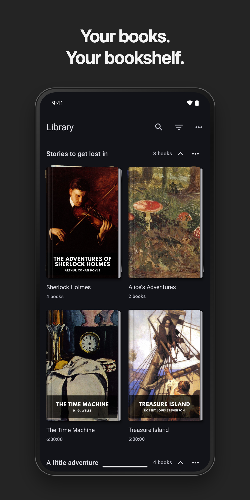
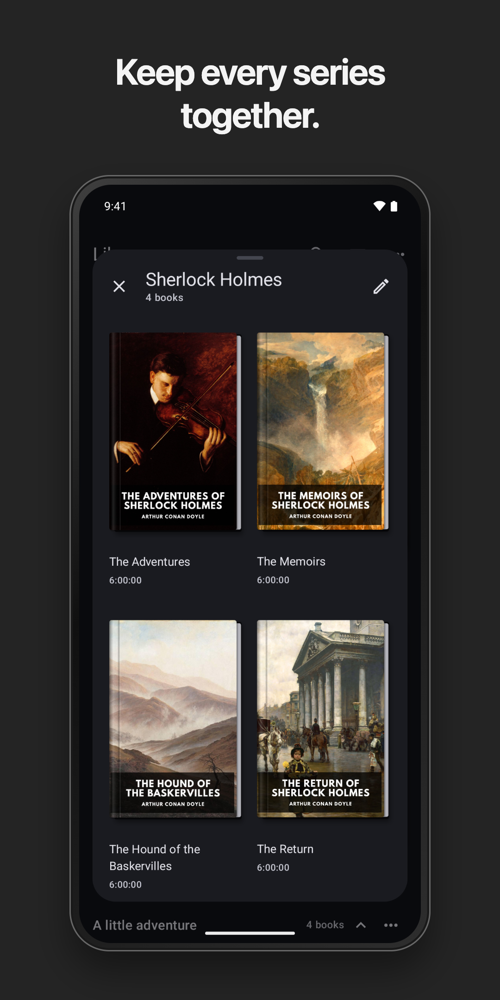
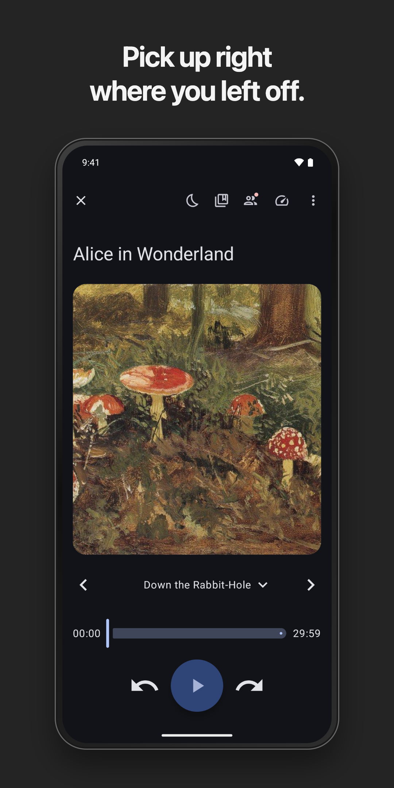
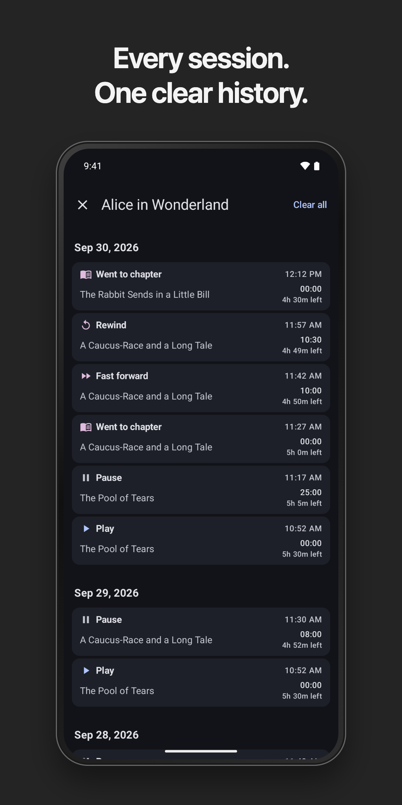
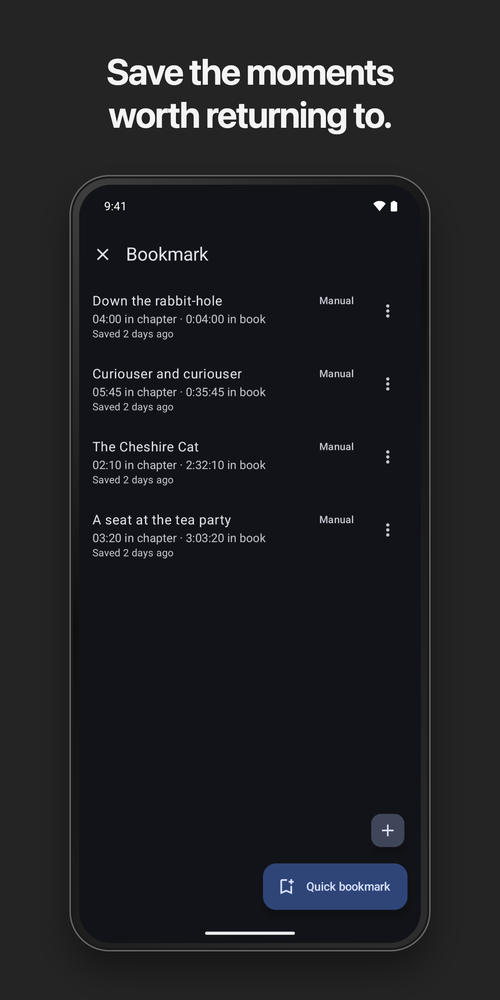
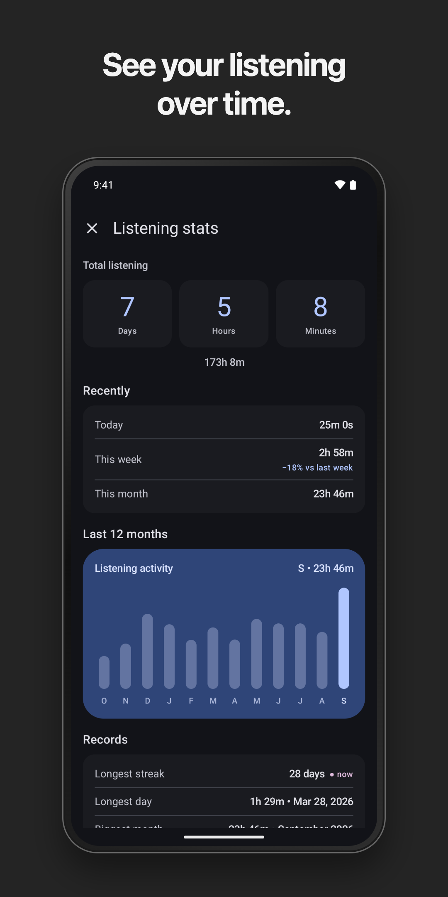
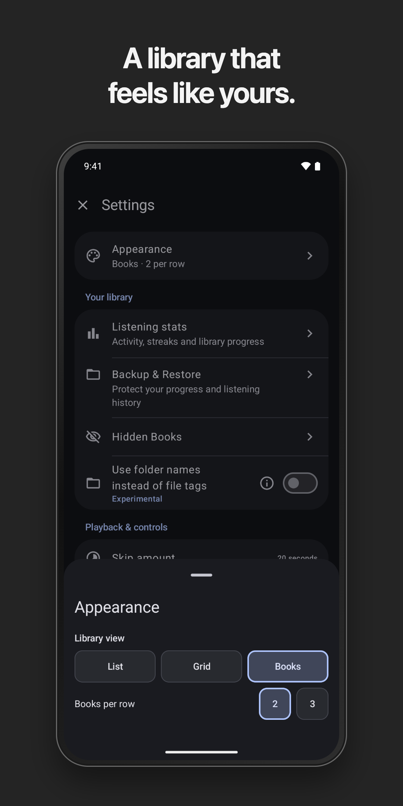
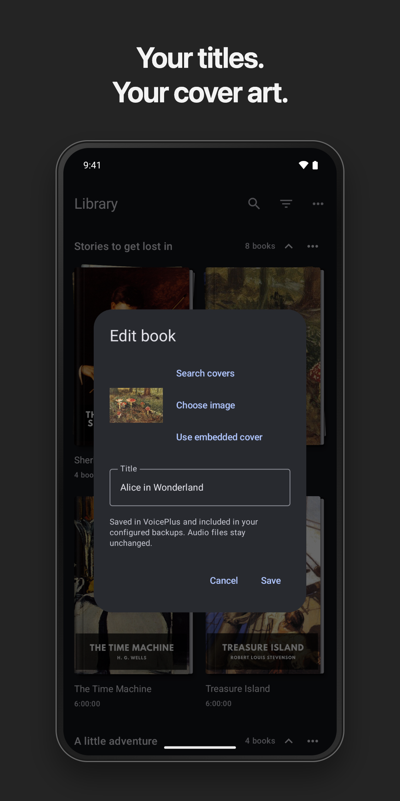
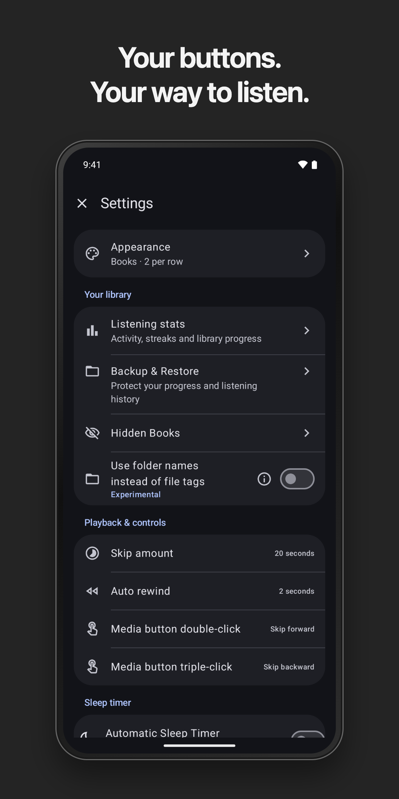

# VoicePlus

[](https://www.gnu.org/licenses/gpl-3.0)
[](https://f-droid.org/packages/com.github.mistermo_vibecode.voiceplus/)
[](https://github.com/Mistermo-vibecode/VoicePlus/releases)
[](https://github.com/Mistermo-vibecode/VoicePlus/actions/workflows/ci.yml)

An open-source audiobook player for Android, with personal shelves, series grouping, listening history and flexible playback controls. No accounts, ads or analytics.

Built on [Voice](https://github.com/PaulWoitaschek/Voice) by Paul Woitaschek and contributors.

## Screenshots

<p align="center">
  <a href="docs/screenshots/phone/library.png"></a>
  <a href="docs/screenshots/phone/series.png"></a>
  <a href="docs/screenshots/phone/playback.png"></a>
</p>
<p align="center">
  <a href="docs/screenshots/phone/listening-log.png"></a>
  <a href="docs/screenshots/phone/bookmarks.png"></a>
  <a href="docs/screenshots/phone/listening-statistics.png"></a>
</p>

### Make it yours

<p align="center">
  <a href="docs/screenshots/phone/appearance.png"></a>
  <a href="docs/screenshots/phone/edit-book.png"></a>
  <a href="docs/screenshots/phone/playback-settings.png"></a>
</p>

---

## Features

- **Library**: personal shelves, series stacks with shared character lists, drag to arrange, and sorting by title, author, date added or length
- **Up next**: queue books to play one after another
- **About this book**: synopsis, narrator and details for every book, and your own 1–5 star ratings
- **Listening history**: a log with chapter positions, plus statistics with finish dates and records
- **Sleep timer**: chapter countdowns, and a reset when you interact
- **Your edits**: bookmarks, chapter names, titles and covers, all without changing your audio files
- **Controls your way**: player toolbar, lock screen, media buttons, widget, theme and colors
- **Your folders**: rename or move a book's folder and it keeps its progress, bookmarks and history
- **Backups**: Android system backup, plus automatic and manual saves to a folder you choose
- **Private**: no accounts, ads, analytics or telemetry

See the [changelog](CHANGELOG.md) for what changed in each release.

---

## Download

[](https://f-droid.org/packages/com.github.mistermo_vibecode.voiceplus/)

Or grab and sideload the APK from the [Releases](https://github.com/Mistermo-vibecode/VoicePlus/releases) page.

---

## Build from source

Requires JDK 21 and Android SDK. See [development instructions](docs/development.md) for setup and tests, and `gradle/libs.versions.toml` for exact versions.

```bash
git clone https://github.com/Mistermo-vibecode/VoicePlus.git
cd VoicePlus
./gradlew :app:assembleLibreRelease
```

---

## License

GPL v3 — see [LICENSE.md](LICENSE.md).
Upstream Voice copyright Paul Woitaschek and contributors. VoicePlus modifications copyright Mistermo.
